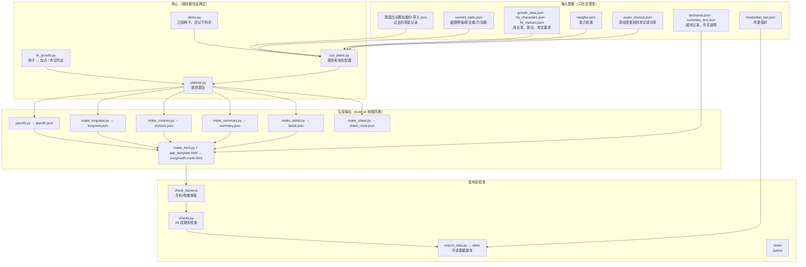

# 系统设计和模块分工

这个仓库做的事：用游戏的升级种子算出每个角色接下来每一级、每个职业会加什么能力，
按 Yizhuo 定下的规则自动规划到 Lv35 / Lv45 的路线（正常升级 / 转职 / 考试 / 跳过），
生成「成长路线」网页和主表用的数据，并在发布前自动检查。

## 分层



## 模块

| 层 | 文件 | 做什么 |
|---|---|---|
| 机制 | `fe_growth.py` | 游戏机制本身：Xorshift128 种子、`next_seed`、`level_up`（加点，保底 2 项重抽）、`exam_roll`（考试判定值）、成长率合成（角色 + 职业 + 坐骑）。不含任何个人规则。 |
| 机制 | `solve.py`、`csolve/` | 反推种子：从观星记录暴力搜索唯一种子（C 程序），再往回接链。只在新角色/种子丢了时用。 |
| 数据 | `demo.py` | 每个角色反推出的第一条种子 `KNOWN_SEEDS`、记录之间没记下的步 `HIDDEN_STEPS`；`python3 demo.py` 打印回测。 |
| 规则 | `run_plans.py` | **所有 Yizhuo 定下的规则和角色配置都在这里**：角色顺序 `ORDER`、目标等级、优先级 P0/P1/P2（`tier_of`）、已有职业 `OWNED`、可考职业 `ALL_CLASSES`/`EXCLUDE`、必考 `REQUIRED`、跳过条件 `SKIP_RULE`、不跳过的种子 `NO_SKIP_SEEDS`、手形价格、每分金币、考前训练 `TRAIN_TO_PASS`；以及记录修正（`LEVEL_FIX`、`RECORD_FIX`、`EXTRA_AFTER`）、`current_state`（规划起点种子/等级）、`records`（观星记录逐条）、`start_stats`。 |
| 算法 | `planner.py` | 规划算法：`_sim` 逐级选最好的已有职业（加权分 + 均衡 + 体格），按跳过条件决定跳过；`plan_all` / `rule_plan` 枚举要考的职业组合，按净值（加权分 − 金币 − 训练）取最好；`plan_gold`、`plan_net`。 |
| 输出 | `make_sheet.py` | 主表「种子」「成长路线」的行 → `sheet_rows.json`。 |
| 输出 | `make_detail.py` | 每人完整成长档案（入队、每级、每次考试）→ `detail.json`。 |
| 输出 | `make_summary.py` | 到 Lv35 实际 vs 期望（随机种子模拟）→ `summary.json`。 |
| 输出 | `make_choices.py` | 中长期选择的成本/收益/建议（考哪个、跳哪级）→ `choices.json`。 |
| 输出 | `make_longview.py` | 长线观星：往后 40 级每项能力的走势 → `longview.json`。 |
| 输出 | `plan45.py` | 到 Lv45 的路线（每人最多一次上级）→ `plan45.json`。 |
| 输出 | `make_html.py` + `app_template.html` | 把上面全部合成一页「成长路线」网页 → `out/growth-route.html`，同时写 `out/page_data.json` 给检查用；模板变了会自动跑 `check_layout.js`。 |
| 检查 | `check_layout.js` | Playwright 打开网页，电脑和手机宽度、每个标签页都检查没有溢出/重叠。 |
| 检查 | `checks.py` | 把 Yizhuo 过去的检查方式写成程序（D 数据 / P 规划 / U 页面 / G 快照，共 29 项），见 [检查规则.md](检查规则.md)。任何一项不过，`build.sh` 失败，不发布。 |
| 检查 | `tests/` | `test_plan_rules.py` 规则单元测试；`test_checks.py` 把 checks.py 每项当一个测试；`golden_plans.json` 结果快照。 |
| 数据副本 | `export_data.py` → `data/` | 每个角色一份可读的 .json + .md（种子链、过去成长、等级、职业、能力、技能、权重、规划、吃饭喜好）；`checks.py` D5 保证它和程序一致。 |
| 一次性 | `tools/` | 做过一次的分析和表格：过去成长反推（`analyze_past`、`make_past_sheet`）、第 7 章重开（`ch7_plan`、`make_ch7_html`）、主表格式（`make_format`）、旧档案页（`make_detail_html`）。不在 build 里。 |

仓库其他目录：`meals/` 吃饭组合（`diet_combos.py`）；`dietrich/shops-src/` 迪线商店；`levelup/rules/` 规则文档草稿；`data/` 导出的可读数据；`out/` 生成的网页（不进 git）。

## 改东西的时候

| 想改 | 改哪里 | 之后 |
|---|---|---|
| 新的观星记录 / 截图 | `levelup/观星凹点模拟备份-导入.json`、`current_stats.json` | `bash build.sh`；D1/D6 会抓对不上的种子 |
| 规则（跳过、优先级、必考、价格） | `run_plans.py`（必要时 `planner.py`），在 `decisions.json` 记一笔 | `bash build.sh`；G1 会列出每人路线变了什么，确认后 `python3 checks.py --update-golden` |
| 页面样式 / 文案 | `app_template.html`、`make_html.py` | `bash build.sh`（自动排版检查）；文案里不要手写数字（U8） |
| 新角色 | `demo.KNOWN_SEEDS`、`run_plans.ORDER/OWNED`、`weights.json`、`current_stats.json` | D2/D3/D7 会提示缺什么 |

## 一条命令

```bash
cd levelup/rng
bash build.sh                      # 生成全部 → 排版检查 → 29 项检查 → 导出 data/
python3 checks.py                  # 只跑检查（约 6 秒）
python3 checks.py P5 U4            # 只跑某几项
python3 checks.py --update-golden  # 有意改了规则后更新快照（会打印变化）
python3 -m pytest -q tests         # 测试
```
