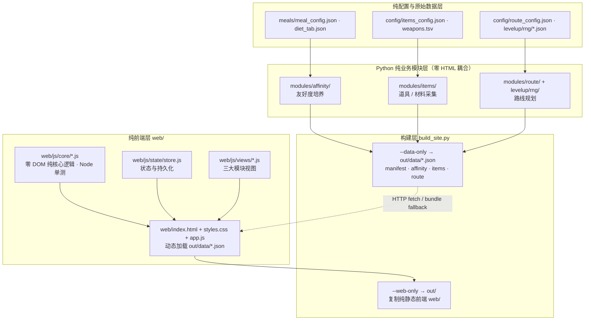

# 系统设计和模块分工（v2 模块化架构）

本仓库按三大业务功能清晰分模块，并将**纯配置数据 / 纯业务逻辑 / 数据构建 / 静态前端**彻底解耦，确保核心逻辑前后端均可单元测试，且改动网页不需要重跑规划算法。

## 总体分层与三大模块



## 三大功能模块职责

| 模块 | 纯配置数据 | 后端纯逻辑 | 独立数据产物 | 前端纯逻辑（可单测） | 前端视图 |
|---|---|---|---|---|---|
| **友好度培养** | `meals/meal_config.json`, `meals/diet_tab.json` | `modules/affinity/planner.py`, `service.py` | `out/data/affinity.json` | `web/js/core/affinity_logic.js` | `web/js/views/affinity_view.js` |
| **道具 / 材料采集** | `config/items_config.json`, `dietrich/shops-src/weapons.tsv` | `modules/items/catalog.py`, `service.py` | `out/data/items.json` | `web/js/core/items_logic.js` | `web/js/views/items_view.js` |
| **路线规划** | `config/route_config.json`, `levelup/rng/*.json` | `modules/route/config_loader.py`, `service.py`, `levelup/rng/{fe_growth,planner,run_plans}.py` | `out/data/route.json` | `web/js/core/route_logic.js` | `web/js/views/route_views.js` |

## 常用命令

```bash
# 前端纯核心逻辑单元测试（Node.js 内置 test runner）
node --test web/tests/*.test.js

# Python 三大模块与架构单元测试
python3 -m unittest discover -s tests -v

# 仅重算三大模块数据（不碰前端）
python3 build_site.py --data-only

# 仅部署前端静态文件（不跑规划算法，<0.1s）
python3 build_site.py --web-only

# 完整重建（含路线中间 JSON + 三大模块数据 + 前端 + data/ 导出 + 38 项自动检查）
bash levelup/rng/build.sh
```

更多开发铁律与 Agent 守则见根目录 [AGENTS.md](../AGENTS.md) 与 `.agents/skills/`。
